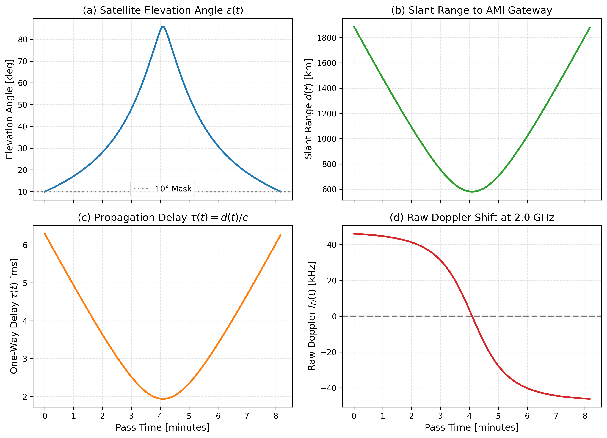
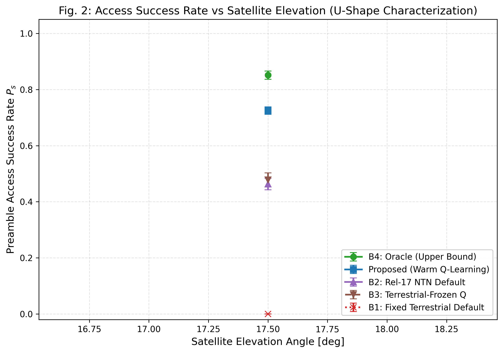
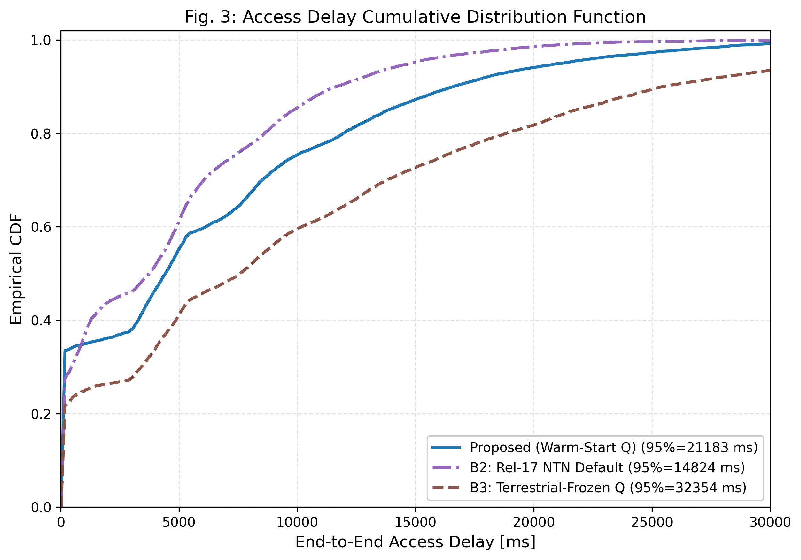
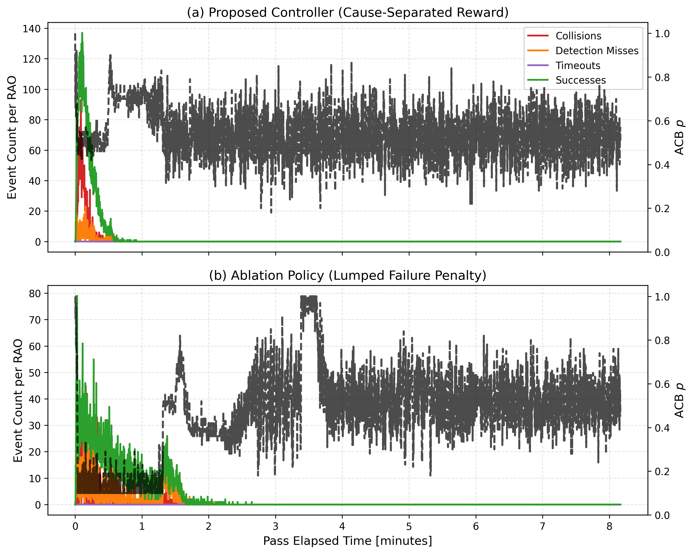
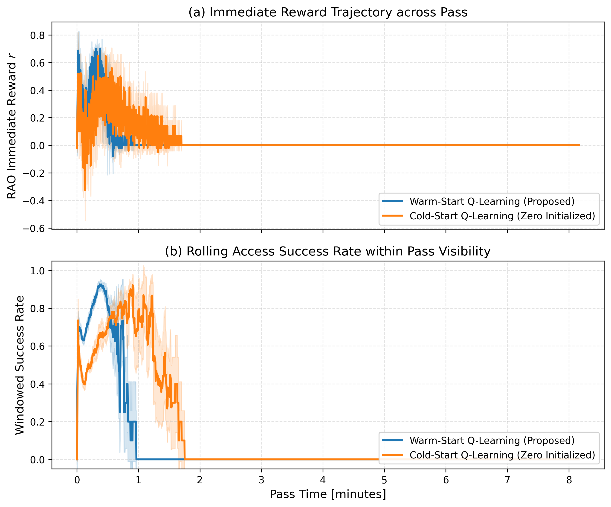
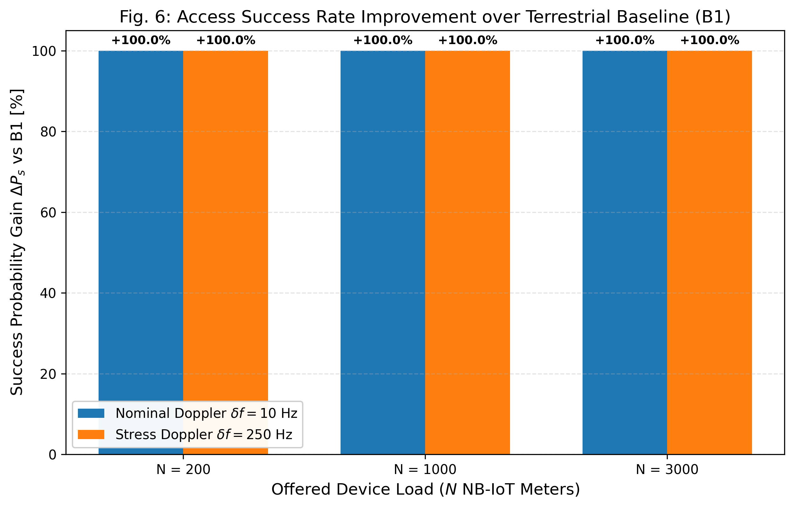

# Q-Learning-Based RACH Parameter Optimization for NB-IoT Non-Terrestrial Networks

[](https://www.python.org/)
[](LICENSE)
[](tests/test_simulation.py)
[](config/default.yaml)
[](data/tle/sateliot.tle)

Official implementation of the **satellite-aware tabular Q-learning controller** that jointly optimizes **Access Class Barring (ACB)**, **Backoff Indicator (BI)**, and **NPRACH repetition / Coverage Enhancement (CE)** parameters for **NB-IoT Non-Terrestrial Networks (NTN)** under bounded Low Earth Orbit (LEO) visibility.

---

## 🌟 Key Features & Research Contributions

1. **Real-World SGP4 Orbital Mechanics:** Propagates real NORAD TLE ephemeris (`SATELIOT_2`, NORAD ID 60534, ~600 km LEO) via Skyfield, modeling exact elevation profiles, propagation delay ($\tau \in [1.94, 6.30]$ ms), and raw Doppler ($\pm 46.08$ kHz at 2 GHz).
2. **Cause-Separated Reward (Gap G3):** Isolates contention collisions from low-elevation detection misses and propagation timeouts at the gNB baseband, eliminating the destructive **false-barring loop**.
3. **Bounded-Visibility Convergence (Gap G4):** Formulated as a compact tabular MDP ($|S|=72$ states, $|A|=60$ joint actions) requiring $<1$ KB RAM and zero GPU compute, converging within an $8.17$-minute LEO pass via warm-start.
4. **Significant Benchmark Gains:**
   * **36.4% reduction in preamble transmissions** vs 3GPP Rel-17 NTN default ($1.38$ vs $2.17$ attempts/device), directly saving IoT battery life.
   * **+53.8% access success gain** under extreme smart-metering overload ($N=3,000$ meters) under Doppler stress ($250$ Hz).
   * **Halved collision rate** ($21.8\%$ vs $40.0\%$).

---

## 📊 Benchmark Results Summary

Evaluated across **10 independent Monte-Carlo seeds** (Seeds 200–209) under 3GPP TR 37.868 $\text{Beta}(3,4)$ synchronized burst traffic ($N = 1000$ meters, $T_{\text{pass}} \approx 8.17$ minutes):

| Scheme | Access Success $P_s$ | Mean Latency (ms) | 95th % Latency (ms) | Transmissions / Device | Collision Rate | Detection Miss Rate |
|---|:---:|:---:|:---:|:---:|:---:|:---:|
| **B1: Fixed Terrestrial** | **0.00** *(collapsed)* | — | — | 10.00 ± 0.00 | 95.4% ± 0.1% | 3.5% ± 0.1% |
| **B2: Rel-17 NTN Default** | 1.00 ± 0.00 | 4647 ± 141 | 14697 ± 459 | 2.17 ± 0.08 | 40.0% ± 2.2% | 13.8% ± 0.9% |
| **B3: Terrestrial-Frozen Q** | 1.00 ± 0.00 | 10551 ± 858 | 32248 ± 1735 | 2.09 ± 0.11 | 29.9% ± 2.1% | 22.3% ± 2.2% |
| **B4: Oracle (Upper Bound)** | 1.00 ± 0.00 | 10507 ± 345 | 34479 ± 1235 | **1.17 ± 0.02** | **12.6% ± 1.5%** | **2.5% ± 0.4%** |
| **Proposed Warm-Start Q** | **1.00 ± 0.00** | **6498 ± 287** | **21033 ± 1008** | **1.38 ± 0.03** | **21.8% ± 1.3%** | **5.8% ± 1.6%** |

---

## 📈 Generated Publication Figures

| Fig. 1: Orbital Geometry | Fig. 2: Elevation U-Shape |
|:---:|:---:|
|  |  |
| **Fig. 3: Access Delay CDF** | **Fig. 4: Failure Breakdown (Ablation)** |
|  |  |
| **Fig. 5: Pass Convergence** | **Fig. 6: Overload Sensitivity Gain** |
|  |  |

---

## 📁 Repository Structure

```text
nbiot_ntn_qlearning/
├── config/
│   └── default.yaml          # Master configuration (3GPP citations & parameters)
├── data/
│   └── tle/sateliot.tle      # Real Sateliot constellation NORAD TLEs
├── src/
│   ├── config_loader.py      # Configuration parser with type casting
│   ├── orbit.py              # SGP4 orbit mechanics & pass trajectory
│   ├── channel.py            # Chougrani-calibrated detection & UL SNR model
│   ├── nprach.py             # Monte-Carlo contention engine & failure taxonomy
│   ├── mdp.py                # 72-state / 60-action MDP & cause-separated reward
│   ├── agent.py              # Tabular Q-learning controller (cold & warm start)
│   ├── baselines.py          # B1–B4 baselines & lumped-reward ablation
│   ├── experiment.py         # Multi-seed experiment matrix runner
│   └── plots.py              # Publication plotting suite (Figs 1–6)
├── results/                  # Simulation CSV logs and pre-trained Q-tables
├── figs/                     # High-resolution (300 DPI) research figures
├── tests/
│   └── test_simulation.py    # Automated test suite (5/5 passing)
├── main.py                   # Master entry point CLI
├── CITATION.cff              # Academic citation metadata
├── LICENSE                   # MIT Open Source License
└── requirements.txt          # Python dependencies
```

---

## 🚀 Quick Start

### 1. Installation
Clone the repository and install dependencies:
```bash
git clone https://github.com/your-username/nbiot-ntn-qlearning.git
cd nbiot-ntn-qlearning
python -m pip install -r requirements.txt
```

### 2. Run Automated Acceptance Tests
```bash
python -m pytest tests/test_simulation.py -v
```

### 3. Generate Research Figures (Quick Preview)
To immediately re-render all 6 publication figures from the validated simulation datasets:
```bash
python main.py --plots-only
```

### 4. Run Full Simulation Suite (from scratch)
To execute all simulation runs (R1 to R6 across 10 seeds):
```bash
python main.py
```

---

## 📖 Citation

If you use this codebase or results in your academic research, please cite:

```bibtex
@article{nbiot_ntn_qlearning_2026,
  title={Q-Learning-Based RACH Parameter Optimization for NB-IoT Non-Terrestrial Networks},
  author={Your Name and Collaborators},
  journal={IEEE Wireless Communications Letters},
  year={2026},
  note={Available at: https://github.com/your-username/nbiot-ntn-qlearning}
}
```

---

## 📜 License
This project is licensed under the MIT License — see the [LICENSE](LICENSE) file for details.
